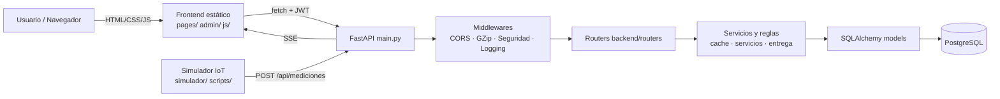

# Arquitectura de AquaPlants

Documento de referencia de la implementación: componentes, responsabilidades,
flujos principales y decisiones de diseño. Complementa `README.md`,
`docs/base-datos.md`, `docs/seguridad.md` y `docs/instalacion-entorno.md`.

## 1. Objetivo del sistema

AquaPlants centraliza el monitoreo de cultivos hidropónicos: registra
mediciones ambientales, evalúa umbrales, genera alertas y notificaciones y
ofrece módulos operativos (tareas, incidencias, inventario, calendario, mapa y
rendimiento) con control de acceso por rol.

## 2. Stack tecnológico

| Capa | Tecnología | Ubicación |
| --- | --- | --- |
| Frontend | HTML5, CSS3 y JavaScript ES5/ES6 sin framework | `index.html`, `pages/`, `admin/`, `css/`, `js/` |
| API | FastAPI + Pydantic v2 | `main.py`, `backend/routers/` |
| Persistencia | SQLAlchemy ORM + PostgreSQL (`psycopg`) | `backend/models.py`, `backend/database.py` |
| Autenticación | JWT (HS256) + bcrypt (passlib) | `backend/security.py`, `backend/routers/auth.py` |
| Servidor API | Uvicorn (1..N workers) | `serve.py` |
| Servidor estático | `python -m http.server` o Nginx | README, `deploy/nginx.conf` |
| Despliegue | Docker + Docker Compose + Nginx | `Dockerfile`, `docker-compose.yml`, `deploy/` |
| Pruebas | pytest + FastAPI TestClient (SQLite en memoria) | `tests/` |
| Calidad | ruff (lint) + GitHub Actions | `ruff.toml`, `.github/workflows/ci.yml` |

## 3. Diagrama de componentes

## 4. Organización del backend

- `main.py`: crea la app, registra middlewares, routers, manejador global de
  errores y endpoints de salud.
- `backend/config.py`: carga `.env`, valida configuración crítica
  (`SECRET_KEY`, `CORS_ORIGINS`, credenciales de BD) y expone constantes.
- `backend/database.py`: engine con pool, `SessionLocal`, `get_db` e
  inicialización aditiva del esquema (`init_db`).
- `backend/models.py`: 23 tablas ORM con relaciones, índices y restricciones.
- `backend/schemas.py` y `schemas_ops.py`: validación de entrada/salida.
- `backend/security.py`: hash de contraseñas, emisión/validación de JWT y
  dependencias de autorización por rol y alcance de cultivos.
- `backend/cache.py`: caché TTL, limitadores de tasa y control de spam de
  notificaciones.
- `backend/routers/*`: endpoints agrupados por dominio.

Routers registrados en `/api`:

| Router | Dominio |
| --- | --- |
| `auth` | Login, perfil, cambio de contraseña, recuperación |
| `mediciones` | Registro y listado de lecturas IoT |
| `dashboard` | Indicadores agregados |
| `alertas` | Lectura/resolución de alertas |
| `cultivos` | CRUD de cultivos y alcance por encargado |
| `historicos` | Series temporales por rango |
| `riego` | Zonas, programación e historial |
| `usuarios` | Administración de cuentas y asignaciones |
| `instalaciones` | Sectores/instalaciones y administración |
| `dispositivos` | Inventario de hardware |
| `umbrales` | Reglas global/instalación/cultivo |
| `reportes` | Resumen, exportación CSV e historial |
| `notificaciones` | Centro de notificaciones y SSE |
| `incidencias` | Registro y seguimiento |
| `tareas` | Kanban operativo |
| `inventario` | Productos, movimientos y solicitudes |
| `calendario` | Eventos agrícolas |
| `mapa` | Mapa de sectores |
| `equipo` | Actividad y asignaciones del equipo |
| `rendimiento` | Indicadores de desempeño |

## 5. Organización del frontend

- `index.html` + `js/login.js`: inicio de sesión y recuperación de contraseña.
- `js/layout.js`: inyecta barra lateral, topbar, buscador global, centro de
  notificaciones, temas y filtros globales en todas las páginas.
- `js/api.js`: cliente `fetch` centralizado con token y manejo de 401.
- `pages/`: 19 vistas funcionales (dashboard por rol, cultivos, alertas,
  históricos, dispositivos, riego, reportes, mapa, tareas, incidencias,
  calendario, equipo, inventario, comparador, rendimiento, notificaciones,
  perfil).
- `admin/`: 4 vistas administrativas (usuarios, instalaciones, dispositivos,
  umbrales).
- `css/`: `aqua-identity.css` define tokens de diseño, tema claro/oscuro y
  componentes unificados; los demás archivos agregan estilos por módulo.
- `simulador/`: banco de pruebas que envía mediciones reales a la API.

## 6. Flujos principales

### 6.1 Autenticación

1. El cliente envía credenciales a `POST /api/auth/login` (form-urlencoded).
2. La API aplica el limitador de intentos, valida bcrypt y emite un JWT con
   `sub`, `role`, `ver` y `exp`.
3. Cada petición protegida resuelve el usuario, verifica `activo` y que
   `ver` coincida con `usuarios.token_version`.
4. Cambiar o recuperar la contraseña incrementa `token_version`, invalidando
   los tokens anteriores.

### 6.2 Medición → umbral → alerta → notificación

1. `POST /api/mediciones/` valida rangos (temperatura, humedad, pH, etc.).
2. Se evalúan umbrales con prioridad global < instalación < cultivo.
3. Si una variable sale de rango se crea una `Alerta`.
4. Se crean notificaciones para encargados del cultivo (o responsable de la
   instalación / administradores), con anti-spam por cultivo y variable.
5. El panel se actualiza por SSE (`/api/notificaciones/stream`) y por sondeo.

### 6.3 Autorización por rol

- `admin`/`administrador`: acceso global y mutaciones administrativas.
- `supervisor`: lectura global.
- `encargado`: solo cultivos en `usuario_cultivo` (y sectores asignados en los
  módulos operativos).

La autorización siempre se valida en la API; ocultar un control en el navegador
no concede permisos.

## 7. Decisiones de diseño y compromisos

- **Sin framework de frontend:** menor acoplamiento y despliegue estático
  simple; se compensa con `layout.js` como capa de componentes y
  `aqua-identity.css` como sistema de diseño.
- **JWT stateless + `token_version`:** permite escalar horizontalmente y a la
  vez revocar sesiones al cambiar contraseña.
- **SQLite en pruebas, PostgreSQL en operación:** pruebas rápidas y aisladas;
  la suite no toca la base real. La validación final con PostgreSQL es manual.
- **`create_all` + migraciones aditivas:** evita pérdida de datos en bases
  existentes sin introducir una herramienta de migraciones completa. No
  reemplaza un sistema como Alembic.
- **Caché en memoria y limitadores por proceso:** simples y sin dependencias,
  pero cada worker tiene su propio estado; para varios workers conviene Redis.
- **Riego y dispositivos sin lazo físico:** el sistema registra estado,
  horarios e historial, pero no controla bombas ni recibe telemetría sin un
  controlador IoT.

## 8. Documentos relacionados

- `docs/base-datos.md`: modelo entidad-relación, normalización e índices.
- `docs/seguridad.md`: controles, amenazas y limitaciones.
- `docs/instalacion-entorno.md`: configuración reproducible paso a paso.
- `docs/trazabilidad-interfaz.md`: correspondencia interfaz ↔ negocio ↔ API.
- `docs/plan-pruebas.md`: protocolo, casos, resultados y recomendaciones.
- `docs/rubrica-cumplimiento.md`: matriz de cumplimiento de la rúbrica.
