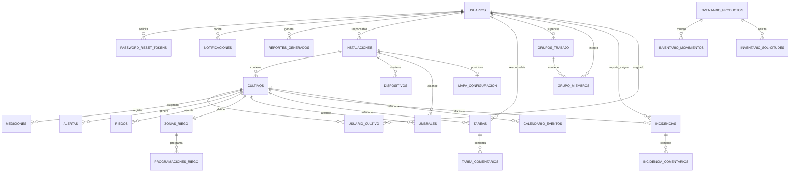

# Base de datos de AquaPlants

Modelo de datos, relaciones, normalización, índices y pautas de mantenimiento.
La fuente de verdad del esquema es `backend/models.py`; la inicialización y las
migraciones aditivas viven en `backend/database.py`.

## 1. Motor y configuración

- **Motor:** PostgreSQL.
- **Driver:** `psycopg` mediante SQLAlchemy.
- **Codificación:** UTF-8, configuración predeterminada de PostgreSQL.
- **Zona horaria:** las fechas de la aplicación se manejan en UTC
  (`backend/utils.utcnow`) y las conexiones fijan la zona horaria de sesión a
  UTC.
- **Pool:** `pool_size` (10 por defecto) + `max_overflow` (20), `pool_pre_ping`
  y `pool_recycle=3600`. El total de conexiones es
  `API_WORKERS × (DB_POOL_SIZE + DB_MAX_OVERFLOW)`.

## 2. Inventario de tablas

| # | Tabla | Propósito |
| --- | --- | --- |
| 1 | `usuarios` | Cuentas, rol, estado, contacto de respaldo y versión de token |
| 2 | `password_reset_tokens` | Códigos y enlaces de recuperación hasheados y su estado |
| 3 | `instalaciones` | Sectores/invernaderos con responsable y estado |
| 4 | `dispositivos` | Sensores/actuadores/controladores asociados a instalación |
| 5 | `cultivos` | Cultivos hidropónicos y su instalación opcional |
| 6 | `usuario_cultivo` | Asignación N:M entre encargados y cultivos |
| 7 | `mediciones` | Lecturas IoT: temperatura, humedad, agua, pH, conductividad |
| 8 | `alertas` | Alertas generadas por umbrales con lectura y resolución |
| 9 | `riegos` | Ejecuciones de riego e historial real |
| 10 | `zonas_riego` | Estado y duración programada por cultivo (1:1) |
| 11 | `programaciones_riego` | Horarios recurrentes de una zona |
| 12 | `umbrales` | Reglas por variable con alcance global/instalación/cultivo |
| 13 | `reportes_generados` | Historial de reportes por usuario |
| 14 | `notificaciones` | Centro de notificaciones por usuario |
| 15 | `incidencias` | Reportes de problemas con estado y responsable |
| 16 | `incidencia_comentarios` | Bitácora de una incidencia |
| 17 | `tareas` | Tareas operativas con responsable y estado |
| 18 | `tarea_comentarios` | Bitácora de una tarea |
| 19 | `inventario_productos` | Productos, stock y mínimo |
| 20 | `inventario_movimientos` | Entradas/salidas que actualizan el stock |
| 21 | `inventario_solicitudes` | Solicitudes de insumos y su aprobación |
| 22 | `calendario_eventos` | Eventos agrícolas y su ejecución |
| 23 | `mapa_configuracion` | Posición/tamaño/color de sectores en el mapa |
| 24 | `grupos_trabajo` | Grupo operativo con supervisor, color y estado |
| 25 | `grupo_miembros` | Asignaci??n N:M entre grupos y encargados |

## 3. Modelo entidad-relación (núcleo)



Las entidades de inventario, calendario y mapa se relacionan opcionalmente con
`instalaciones`, `cultivos` y `usuarios` mediante claves foráneas con
`ON DELETE SET NULL` para no perder el histórico cuando se elimina una
referencia.

## 4. Normalización

### 4.1 Primera forma normal (1NF)

Todas las columnas son atómicas: no hay listas ni grupos repetidos. Los
contactos de respaldo (`email_respaldo`, `telefono_respaldo`) son columnas
separadas; los comentarios y movimientos viven en tablas propias.

### 4.2 Segunda forma normal (2NF)

Cada tabla usa una clave primaria subrogada simple (`id`) y sus atributos
dependen por completo de ella. La tabla puente `usuario_cultivo` resuelve la
relación N:M sin duplicar datos en `usuarios` ni en `cultivos`.

### 4.3 Tercera forma normal (3NF)

Los atributos no clave dependen solo de la clave primaria. Ejemplos:

- `cultivos.instalacion_id` referencia la instalación en lugar de repetir su
  nombre/ubicación.
- `incidencias` y `tareas` guardan `sector_id`, `cultivo_id` y `usuario_id` en
  lugar de copiar nombres.
- El stock se calcula desde `inventario_productos.stock`, actualizado por
  `inventario_movimientos`; no se almacena un total duplicado.

### 4.4 Desnormalización intencional (datos históricos)

Se conservan copias deliberadas para preservar el contexto de un evento:

- `alertas.umbral` y `alertas.valor_detectado`: valor de la regla y de la
  lectura en el momento de la alerta.
- `riegos.zona`, `riegos.duracion_minutos`, `riegos.consumo_litros`: hechos de
  la ejecución, aunque la zona o el cultivo cambien después.
- `reportes_generados.total_registros` y `tamano_bytes`: metadatos del archivo
  generado.

Estas copias son de solo lectura histórica, no sustituyen a las entidades
normalizadas.

## 5. Índices

Además de los índices de claves foráneas usados en listados, se declaran índices
compuestos para las consultas más frecuentes:

| Tabla | Índice | Uso |
| --- | --- | --- |
| `mediciones` | `(cultivo_id, fecha_hora)` | Series por cultivo y rango |
| `mediciones` | `(fecha_hora)` | Históricos globales |
| `alertas` | `(cultivo_id, leida, resuelta)` | Bandeja de alertas por cultivo |
| `alertas` | `(resuelta, fecha_hora)` | Conteos y alertas activas |
| `notificaciones` | `(usuario_id, leida)` | Centro de notificaciones |
| `incidencias` | `(estado, prioridad)` y `(estado, fecha_creacion)` | Tablero y paginación |
| `tareas` | `(estado, fecha_limite)` y `(responsable_id, estado)` | Kanban y "mis tareas" |
| `calendario_eventos` | `(fecha_inicio, estado)` | Agenda por rango |
| `usuario_cultivo` | único `(usuario_id, cultivo_id)` | Evita duplicados y acelera scoping |
| `umbrales` | único `(variable, instalacion_id, cultivo_id)` | Evita reglas duplicadas |
| `reportes_generados` | `(usuario_id, fecha_generacion)` | Historial por usuario |

`ensure_performance_indexes()` crea estos índices si faltan. La inicialización
concurrente en PostgreSQL se serializa con un bloqueo asesor.

## 6. Integridad referencial

- **CASCADE:** datos dependientes que no tienen sentido sin el padre
  (`password_reset_tokens`, `incidencia_comentarios`, `tarea_comentarios`,
  `inventario_movimientos`, `programaciones_riego`, `zonas_riego`, `umbrales`
  de cultivo/instalación, `notificaciones`, `reportes_generados`).
- **SET NULL:** referencias opcionales que deben sobrevivir a la baja del
  padre (`responsable_id`, `sector_id`, `cultivo_id`, `reportado_por`,
  `asignado_a`, `creado_por`).
- **RESTRICT:** `dispositivos.instalacion_id`, para impedir borrar una
  instalación con hardware asociado.
- **UNIQUE:** email/username/email de respaldo, nombre de instalación y
  dispositivo, MAC, código de producto, asignaciones, umbrales y posiciones del
  mapa.

La validación de rangos y formatos (correo, MAC, 6 dígitos de recuperación,
fechas, pH, etc.) ocurre en Pydantic antes de llegar al ORM.

## 7. Rendimiento

- **Paginación:** `offset`/`limit` en mediciones, históricos, alertas,
  notificaciones, incidencias, tareas, inventario y reportes.
- **Carga anticipada:** `joinedload`/`selectinload` para evitar N+1 en
  listados con relaciones.
- **Caché TTL:** dashboards, mapa y rendimiento usan `api_cache` (5–10 s).
- **GZip:** comprime respuestas > 1 KiB, excepto el stream SSE.
- **Índices:** ver sección 5.

## 8. Inicialización y migraciones

`python scripts/setup_db.py` crea el esquema e inserta datos demo solo si la
base no tiene usuarios. Al arrancar, `init_db()`:

1. Crea tablas nuevas con `Base.metadata.create_all`.
2. Agrega de forma aditiva columnas nuevas de versiones anteriores
   (`cultivos.instalacion_id`, `alertas.resuelta`, columnas de recuperación).
3. Deduplica `usuario_cultivo` y crea el índice único.
4. Crea índices de rendimiento faltantes.

**No hay migraciones destructivas.** Antes de actualizar, haz copia de
seguridad:

```powershell
pg_dump -h <host> -U postgres -d postgres -F c -f respaldo_aquaplants.dump
```

## 9. Mantenimiento recomendado

- Programar respaldos diarios y probar la restauración.
- Revisar el crecimiento de `mediciones` y `notificaciones`; archivar por año.
- Ejecutar `ANALYZE` tras cargas masivas.
- Mantener `max_connections` por encima de
  `API_WORKERS × (DB_POOL_SIZE + DB_MAX_OVERFLOW)`.
- Mantener TLS habilitado en las conexiones a PostgreSQL.
